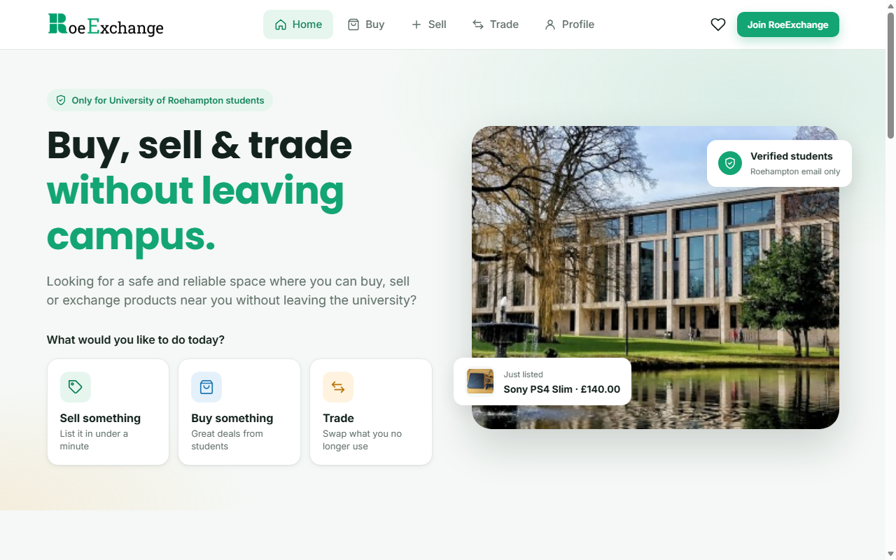

# RoeExchange (redesign)

A university project: a marketplace where University of Roehampton students can buy, sell and swap items without leaving campus. This is the redesigned version; the original coursework is in [roe-exchange-original](https://github.com/RodrigoPerez2803/roe-exchange-original).

**Live site:** https://rodrigoperez2803.github.io/roe-exchange/

## Features

- Student sign-up with field validation (Roehampton email, student ID and college); pages that need an account redirect to sign-up first.
- A store filterable by category, with favourites.
- Product pages with a chat with the seller.
- A step-by-step listing form with photo upload, drag and drop, and image resizing before saving.
- Trades and a profile page.
- All data persists in `localStorage`, with every access wrapped so the site still works when storage is blocked.

Built with plain HTML, CSS and JavaScript; there are no frameworks and no build step. Open `index.html` in a browser.

*Listings and student profiles are sample data, and nothing typed into the forms is sent anywhere.*
